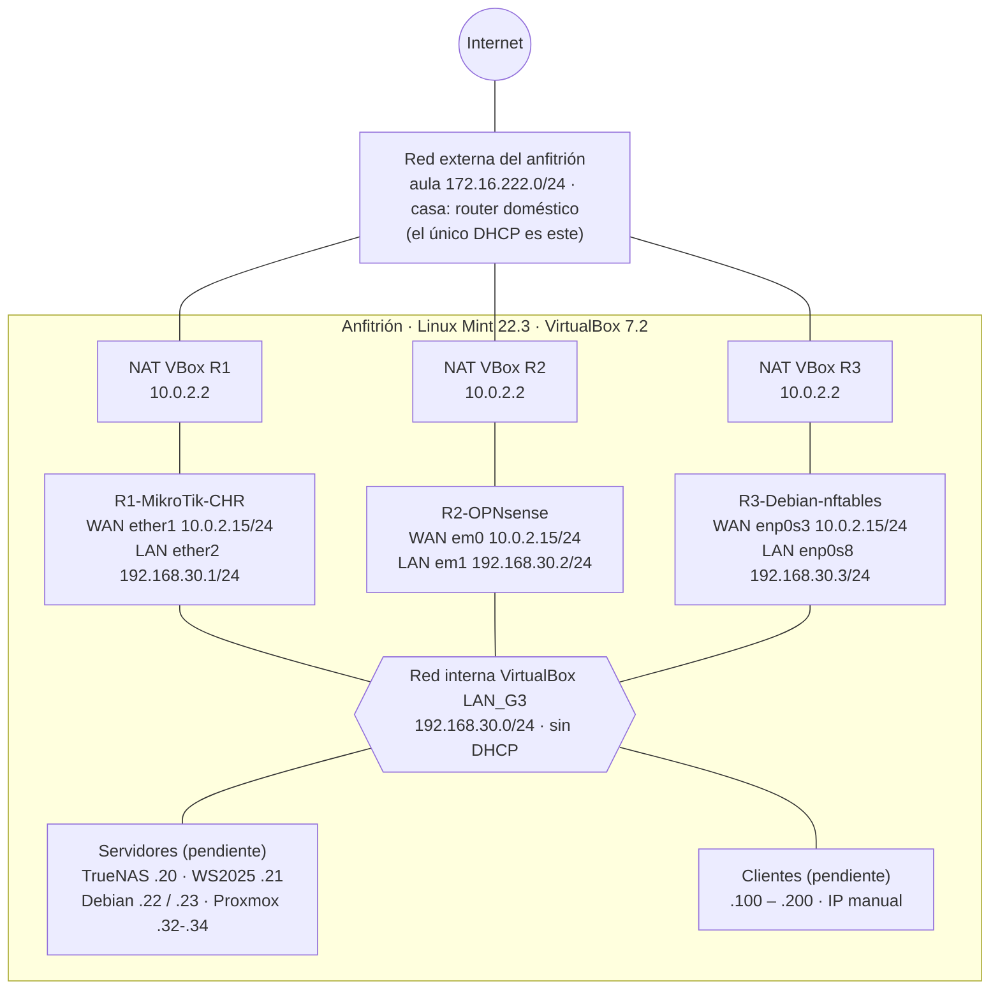

# Esquema lógico del entorno individual (VirtualBox)

Anfitrión: Linux Mint 22.3 en disco externo (se arranca en el PC de clase y en el de casa).

- Línea continua = enlace de red (adaptador virtual).
- Cada router tiene **su propio motor NAT**, por eso los tres comparten la IP WAN `10.0.2.15` sin conflicto.
- La red `LAN_G3` solo existe dentro de VirtualBox: si ningún router está encendido, la LAN no tiene salida.

Referencia del grupo: [arquitectura-referencia-grupo3.png](arquitectura-referencia-grupo3.png).
