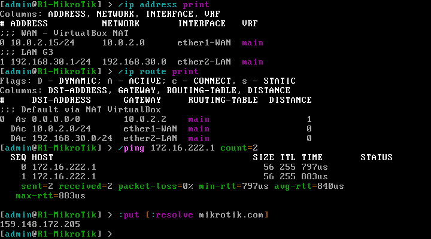
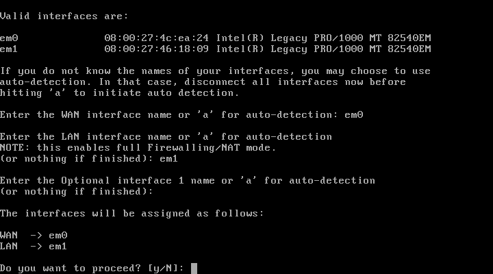
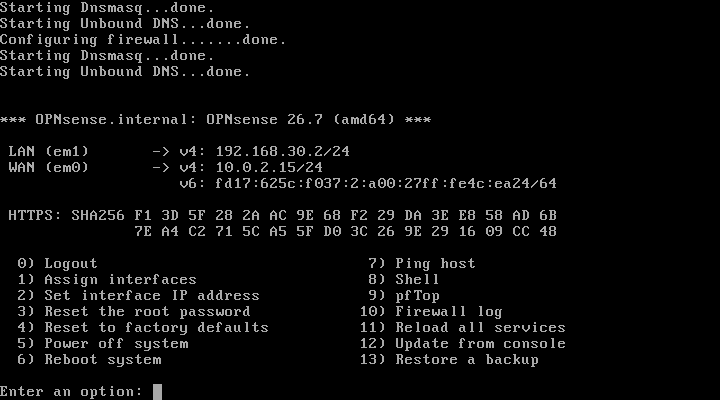
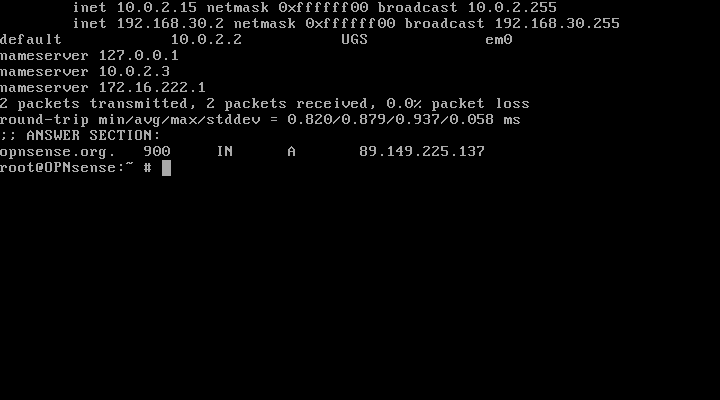

# 05 · Instalaciones y comunicaciones

Tasca 5 «Instal·lació i comunicacions» · RA principales: ISO RA1 d-h y FDM RA1 b-d · **Parte individual**.

> MikroTik, OPNsense y Debian + nftables · Grupo 3 · Fecha: 17/11/2026
> Diseño de red: [04-disseny.md](04-disseny.md) · Recursos: [05-recursos.md](05-recursos.md)

Tareas que pide el enunciado para cada servidor de comunicaciones:

| Tarea | R1 MikroTik | R2 OPNsense | R3 Debian |
|---|---|---|---|
| Configurar el usuario de administración | ✅ `admin` | ✅ `root` | ✅ `asix` (sudo) + `root` |
| Configurar la red WAN y LAN | ✅ | ✅ | ✅ |
| Dar conexión a Internet a la red interna | ✅ | ✅ | ✅ |
| Copia de la configuración en un servidor dedicado | ⏳ pendiente de TrueNAS | ⏳ | ⏳ |
| Provocar un fallo y recuperar | ⏳ | ⏳ | ⏳ |

> Las credenciales se guardan **fuera del repositorio**, como pide el enunciado.

## 1. Necesidad

Los equipos de la empresa necesitan **salir a Internet de forma controlada**. Se montan tres
alternativas de router/cortafuegos sobre la misma LAN para poder compararlas:

| Router | Papel | IP LAN |
|---|---|---|
| MikroTik (RouterOS) | Puerta de enlace principal | 192.168.30.1/24 |
| OPNsense | Cortafuegos tipo "appliance" | 192.168.30.2/24 |
| Debian + nftables | Router GNU/Linux configurado a mano | 192.168.30.3/24 |

## 2. Predicción

- Cada router tendrá dos interfaces: una **WAN** hacia Internet y una **LAN** hacia la empresa.
- Un cliente de la LAN que use uno de estos routers como puerta de enlace saldrá a Internet
  gracias al **NAT (masquerade)**.
- Si **ningún** router está encendido, la LAN no tendrá salida.

## 3. Decisiones

- **MikroTik con imagen CHR** (Cloud Hosted Router) en lugar de la ISO x86. La ISO x86 sin licencia
  es una demo de 24 h. La CHR es la imagen oficial para máquinas virtuales, gratuita y sin
  caducidad; la licencia *free* limita la subida a 1 Mbit/s por interfaz, suficiente para el
  laboratorio.
- **OPNsense con UFS** en lugar de ZFS, porque ZFS necesita más RAM.
- **Debian sin entorno gráfico**: solo red, SSH y nftables.
- **WAN con IP fija `10.0.2.15/24`**, puerta de enlace `10.0.2.2` (NAT de VirtualBox).
- **Ningún servidor DHCP**: todas las IPs internas son manuales (ver [04-disseny.md](04-disseny.md)).
- **DNS del centro, `172.16.222.1`.**

## 4. Implementación

### 4.1 Creación de las VM

Todas están en el grupo `/SOX-G3` de VirtualBox. Ejemplo con MikroTik:

```bash
VBoxManage createvm --name R1-MikroTik-CHR --ostype Linux26_64 --groups /SOX-G3 --register
VBoxManage clonemedium disk chr-7.24.5.vdi "~/VirtualBox VMs/SOX-G3/R1-MikroTik-CHR/R1-MikroTik-CHR.vdi"
VBoxManage modifyvm R1-MikroTik-CHR --memory 256 --cpus 1 \
  --nic1 nat --nic2 intnet --intnet2 LAN_G3 \
  --natpf1 "ssh,tcp,127.0.0.1,2201,,22" --natpf1 "winbox,tcp,127.0.0.1,8291,,8291"
VBoxManage storagectl R1-MikroTik-CHR --name SATA --add sata
VBoxManage storageattach R1-MikroTik-CHR --storagectl SATA --port 0 --type hdd --medium ...
```

### 4.2 R1 · MikroTik CHR 7.24.5

Configuración aplicada por consola. La exportación completa está en
[`configs/R1-MikroTik/R1-MikroTik.rsc`](../configs/R1-MikroTik/R1-MikroTik.rsc).

```routeros
/system identity set name=R1-MikroTik
/user set admin password=********
/ip dhcp-client remove [find]                     # la WAN será fija
/interface ethernet set [find default-name=ether1] name=ether1-WAN
/interface ethernet set [find default-name=ether2] name=ether2-LAN
/ip address add address=10.0.2.15/24 interface=ether1-WAN comment="WAN - VirtualBox NAT"
/ip address add address=192.168.30.1/24 interface=ether2-LAN comment="LAN G3"
/ip route add dst-address=0.0.0.0/0 gateway=10.0.2.2
/ip dns set servers=172.16.222.1 allow-remote-requests=no
/ip firewall nat add chain=srcnat out-interface=ether1-WAN action=masquerade comment="NAT LAN -> WAN"
```

### 4.3 R2 · OPNsense 26.7

1. El archivo `opnsense.vdi` resultó ser la **imagen de instalación en modo live**, no un sistema
   instalado. Se añadió un segundo disco de 10 GB y se ejecutó el instalador (usuario `installer`).
2. Instalación **UFS** en el disco `ada1` (10 GB).
3. Se desconectó el disco live y se arrancó desde el disco instalado.
4. Desde el menú de consola:
   - **Opción 1 · Assign interfaces**: `WAN → em0` (adaptador 1, NAT) y `LAN → em1` (adaptador 2,
     LAN_G3). Se comprobó comparando las MAC.
   - **Opción 2 · Set interface IP address**:
     - LAN: `192.168.30.2/24`, sin puerta de enlace, sin IPv6, **sin servidor DHCP**.
     - WAN: `10.0.2.15/24`, puerta de enlace `10.0.2.2`, DNS `172.16.222.1`, sin IPv6.
5. El NAT de salida está en modo **automático**: hace masquerade de la LAN hacia la WAN.

### 4.4 R3 · Debian 13 + nftables

1. Instalación **desatendida** con `VBoxManage unattended install` desde
   `debian-13.1.0-amd64-netinst.iso`: hostname `r3-debian.g3.lan`, usuario `asix`, sin entorno
   gráfico, con `openssh-server` y `nftables`.
2. Paquetes añadidos: `sudo` y `tcpdump` (para diagnóstico).
3. Archivos de configuración (copia en [`configs/R3-Debian-nftables/`](../configs/R3-Debian-nftables/)):

| Archivo | Para qué |
|---|---|
| `/etc/network/interfaces` | `enp0s3` (WAN) `10.0.2.15/24` gw `10.0.2.2` · `enp0s8` (LAN) `192.168.30.3/24` |
| `/etc/resolv.conf` | `nameserver 172.16.222.1` |
| `/etc/sysctl.d/99-enrutador.conf` | `net.ipv4.ip_forward = 1`: el kernel reenvía paquetes entre interfaces |
| `/etc/nftables.conf` | Cortafuegos + NAT; se carga al arrancar con `systemctl enable nftables` |

Lógica del cortafuegos (`nftables.conf`):

- **input** (tráfico dirigido al propio router), con política `drop`: solo acepta lo ya
  establecido, loopback, ICMP (ping) y SSH.
- **forward** (tráfico que atraviesa el router), con política `drop`: solo permite **LAN → WAN**
  desde `192.168.30.0/24` y sus respuestas (`established,related`).
- **nat postrouting**: `masquerade` de la red LAN al salir por la WAN.

Antes de instalar el archivo se validó la sintaxis con `nft -c -f /etc/nftables.conf`.

## 5. Verificación

| Prueba | R1 MikroTik | R2 OPNsense | R3 Debian |
|---|---|---|---|
| IP WAN 10.0.2.15/24 | ✅ | ✅ | ✅ |
| IP LAN correcta | ✅ .1 | ✅ .2 | ✅ .3 |
| Ruta por defecto vía 10.0.2.2 | ✅ | ✅ | ✅ |
| `ping 172.16.222.1` (DNS del centro) | ✅ 0 % pérdida | ✅ 0 % pérdida | ✅ 0 % pérdida |
| Resolución DNS | ✅ `mikrotik.com` | ✅ `opnsense.org` | ✅ `deb.debian.org` |
| Se ven entre sí en `LAN_G3` | ✅ | ✅ | ✅ (R3 hace ping a .1 y .2) |
| **Enruta y hace NAT a un equipo de la LAN** | ✅ | ✅ | ✅ |
| Sin servidor DHCP | ✅ `/ip dhcp-server` vacío | ✅ nada en el puerto 67 | ✅ nada en el puerto 67 |

**Cómo se probó el NAT sin tener todavía clientes:** se usó un router como "cliente" de otro. Se
añadió una ruta temporal hacia una única IP de Internet (`151.101.134.132`, deb.debian.org) a
través del router que se quería probar:

- Desde R3, con `ip route add 151.101.134.132/32 via 192.168.30.1` (y después `.2`): respuesta
  `HTTP/1.1 200 OK` pasando por MikroTik y por OPNsense.
- Desde R1, con `/ip route add dst-address=151.101.134.132/32 gateway=192.168.30.3`:
  `/tool fetch` devolvió `status: finished` pasando por Debian.

Al acabar cada prueba se borró la ruta temporal.

> El **ping hacia Internet (8.8.8.8) no funciona ni siquiera en directo**: la red del aula filtra el
> ICMP hacia el exterior. Por eso la prueba de NAT se hizo con TCP/80, y el ping solo se usó contra
> `172.16.222.1`.

Evidencias:
- 
- 
- 
- 
- [R3 · salida completa de la verificación](../evidencies/t5-debian-nftables-verificacion-20261117.txt)

## 6. Problemas encontrados y solución

| # | Problema | Causa | Solución |
|---|---|---|---|
| 1 | La ISO de MikroTik no era adecuada para una VM | Era RouterOS **x86** (demo de 24 h sin licencia) | Se usó la imagen oficial **CHR 7.24.5** (VDI) |
| 2 | `opnsense.vdi` no arrancaba un sistema instalado | Era la imagen de instalación **live** | Se añadió un disco de 10 GB y se instaló en él |
| 3 | "No bootable medium found" en OPNsense | La BIOS arranca del primer disco SATA y ahí estaba el disco vacío | Se puso el disco live en el puerto 0 para instalar y después se dejó solo el de sistema |
| 4 | El instalador de OPNsense avisaba de RAM insuficiente | Copiar la imagen live necesita unos 3 GB | Se instaló con 3 GB y después se bajó a 1 GB |
| 5 | El script de postinstalación de VirtualBox falló en Debian (código 1) | Intenta instalar las Guest Additions | No afecta al sistema base. Se instalaron a mano `sudo` y `tcpdump` |
| 6 | Debian se quedó sin DNS al reiniciar | Al apagar, `dhcpcd` (de la antigua config DHCP) sobrescribió `/etc/resolv.conf` | Se reescribió el archivo y se comprobó que se mantiene tras otro reinicio |
| 7 | El ping a 8.8.8.8 falla siempre | La red del aula filtra el ICMP hacia Internet | Las pruebas de NAT se hacen con TCP/80 |
| 8 | La descarga de la imagen CHR se cortaba | Conexión inestable (HTTP/2) | Se reanudó con `curl --http1.1 -C -` y se verificó el ZIP con `7z t` |

## 7. Análisis: ¿coincide con la predicción?

- **Sí:** los tres routers dan salida a la LAN con NAT, y `LAN_G3` no tiene otra salida.
- **Diferencias entre los tres:**
  - **OPNsense** bloquea por defecto todo lo que entra por la WAN y solo permite LAN → cualquier destino.
  - **MikroTik** no filtra nada hasta que se le añaden reglas.
  - **Debian** filtra solo lo que nosotros hemos escrito en `nftables.conf`.

## 8. Pendiente

- [ ] Copia de la configuración de los tres routers en TrueNAS (`192.168.30.20`).
- [ ] Provocar un fallo y recuperar cada router a partir de la copia.
- [ ] OPNsense: cambiar el nombre de host y exportar `config.xml` desde la web (requiere un cliente en la LAN).
- [ ] MikroTik: añadir reglas de filtrado (`/ip firewall filter`) equivalentes a las de Debian.
- [ ] Evidencia de `traceroute` desde un cliente de la LAN (lo pide la Tasca 4, Apto+).
- [ ] Fuera del centro, cambiar el DNS `172.16.222.1` por `10.0.2.3`.
